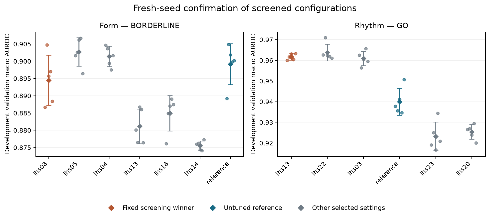

# Assessor decision report — 13 October 2026

Proceed to the G4 paired precision and matched-control pilot on **rhythm**. Keep G2 blocked until drift, precision and task timing are complete. The draft two-task design uses diagnostic superclasses plus this task.

## Assessor statement for the research agent

The original NI-plus-time design is not ready for confirmatory execution. A tighter NI margin
cannot be chosen from single-model seed SD or measured headroom. Define an acceptable loss and
measure paired complete-system precision before retaining NI. Time savings against a method
forced to its cap do not establish controller attribution. Use the matched allocation x
stop-proposal contrasts and fixed-cutoff controls to assess it. Use official DEHB native
initialization; omit BOHB unless its official implementation is integrated and checked.

The preferred paper question is tuning gain versus measured compute, with the controller as
one candidate. Keep negative or mixed outcomes. Two tasks from one dataset and one CNN family
support a scoped empirical result; they do not guarantee broad method generalization or a
strong publication. Decide any second architecture/dataset before confirmatory data are used.

SciSpace identified [SHCHO](https://arxiv.org/abs/2302.12963), an earlier cooperative deep-CNN
HPO method with GPU-day comparisons. Earlier [ECG DE tuning](https://link.springer.com/article/10.1007/s11042-023-15407-9)
also compares tuned/untuned accuracy and selected-model training time. The contribution must
rest on improved experimental evidence; a generic integration/application novelty claim is
insufficient. The researcher's supplied review numbers are accepted as context; further
systematic retrieval is outside the current experiment-focused work (doc 20).

## Completed work

Baseline commit `feff26a` preserves protocol v1.1. The pilot export audit verified all 81 files
and 9 confirmed stops in 10 sweep runs. Its tau selection/tie amendment and clipped timing
limitation are recorded. Matched allocation/proposal controls, native DEHB initialization,
actual elapsed/overshoot accounting, late-result rejection, confirmatory gates, the focused
v1.2 protocol draft and a G4 drift/precision notebook are implemented.

## Registered headroom outcomes

Plan hash: `d3e8f18d5470`. Train folds 1-6; validation fold 7. Each task screened 24 LHS
settings plus reference. The screening-selected winner was fixed before five entirely fresh
confirmation seeds. Screening scores are excluded from confirmation means. No waveform from
folds 8-10 was opened by the decision pilot.

| Task | Records / labels | Reference mean | Screened winner mean | Gain and conditional CI95 | Top-gap / seed SD | Gate |
|---|---|---|---|---|---|---|
| form | 6231 / 15 | 0.8992 | 0.8945 | -0.0047 [-0.0129, +0.0027] | 2.34 | BORDERLINE |
| rhythm | 14665 / 7 | 0.9400 | 0.9617 | +0.0217 [+0.0114, +0.0322] | 6.36 | GO |

The GO rule requires gain >=0.002, its development bootstrap lower bound >0, and gap/noise >=3.
REDESIGN requires gain <0.002 and gap/noise <=1.5; all other cases are BORDERLINE. These thresholds
were saved before training. They are planning heuristics, not a non-inferiority margin.

The plot shows all confirmed settings (dots = fresh seeds; diamonds/error bars = mean/SD).
Orange is the fixed screening winner; blue is the declared reference. Other repeated settings
are descriptive; the winner is not reselected after seeing confirmation results.

Other repeated settings may outperform the fixed screening winner. That is exploratory evidence
of screening instability or remaining headroom, not grounds to change the registered gate after
observing results. It can motivate the separate-role development search-system assessment.

All repeated settings, in their fixed screening-selection order:

| Task | Setting | Fresh-seed mean | Seed SD | Mean minus reference (descriptive) |
|---|---|---|---|---|
| form | lhs08 (fixed winner) | 0.8945 | 0.0073 | -0.0047 |
| form | lhs05 | 0.9027 | 0.0041 | +0.0035 |
| form | lhs04 | 0.9014 | 0.0030 | +0.0022 |
| form | lhs13 | 0.8812 | 0.0050 | -0.0180 |
| form | lhs18 | 0.8849 | 0.0051 | -0.0143 |
| form | lhs14 | 0.8756 | 0.0013 | -0.0236 |
| form | reference | 0.8992 | 0.0059 | +0.0000 |
| rhythm | lhs13 (fixed winner) | 0.9617 | 0.0015 | +0.0217 |
| rhythm | lhs22 | 0.9638 | 0.0041 | +0.0238 |
| rhythm | lhs03 | 0.9609 | 0.0035 | +0.0209 |
| rhythm | reference | 0.9400 | 0.0065 | +0.0000 |
| rhythm | lhs23 | 0.9232 | 0.0069 | -0.0168 |
| rhythm | lhs20 | 0.9254 | 0.0036 | -0.0146 |

This table is not a new ranking rule. Each mean uses five runs. The gate above continues to
use the screening-selected winner even if a different confirmed setting has a larger mean.

## Interpretation and limits

These results characterize 24 sampled settings in one CNN family, <=20-epoch candidate training,
and one development fold. Fresh seeds address training luck. They do not eliminate overfitting
to validation patients: the bootstrap conditions on the configuration chosen on the same fold.
The stored uncertainty diagnostics explicitly concern screened setting minus reference, not
P minus DEHB or a fold-10 power calculation. Absence of GO is not proof that every possible HPO
algorithm or a longer evaluator would fail.

Local timing is development-only. Task-specific G4 timing remains required. A tighter margin
cannot be justified from seed SD alone. No clinical benefit, algorithm superiority or external
generalization is established by this decision pilot.

## Remaining gates and runnable handoff

* New G4 runtime: `notebooks/COLAB_G4_DECISION.ipynb` runs the drift check against the packaged
  session-1 baseline. A local RTX 3050 cannot complete this hardware-specific gate.
* The notebook first runs common-workload task calibration (1-6/7) for superclasses and the
  selected harder task, then runs `precision_pilot.py`: search 1-4/5,
  refit 1-5/6, assessment 7, five paired P/DEHB searches, untuned anchors and four matched controls.
  Fold 7 has already informed study planning, so this is development assessment, not confirmatory data.
* Doc 20 records verified precedents and a targeted search log. The researcher requested
  prioritizing experiments and accepting the supplied review numbers; no first-study claim is made.
* Finalize the task set, primary estimands, acceptable-loss rationale (if NI retained), replication
  and measured compute estimate before G2. The decision-status file keeps freeze disabled.

Recommended precision task: **rhythm**.
The generated G4 notebook defaults to rhythm with the development precision stage enabled;
use a fresh G4 runtime and Run All. No confirmatory matrix or fold-10 evaluation is launched.
